# RodzicPlus — Zasiłkowy Przewodnik Przyszłego Rodzica

Aplikacja dla przyszłych rodziców: mówi, czy dostanie pieniądze z ZUS, ile, jak długo
i co gdzie złożyć.

## Zrzuty ekranu

Wszystkie dane na zrzutach są fikcyjne (profile demo z symulowanego logowania mObywatelem).

| | |
| --- | --- |
| **Moje dane** – dane wpisywane raz, pytania dopasowane do sytuacji<br>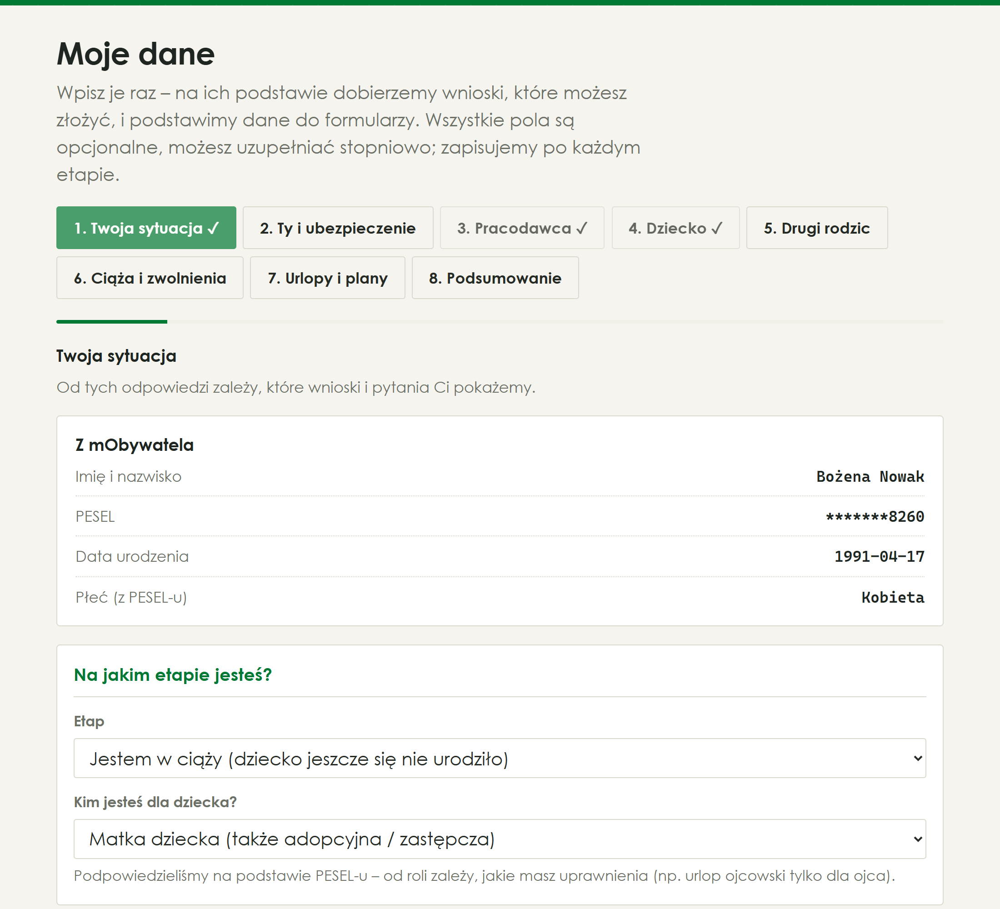 | **Złóż wniosek** – wnioski z licznikami wariantów<br>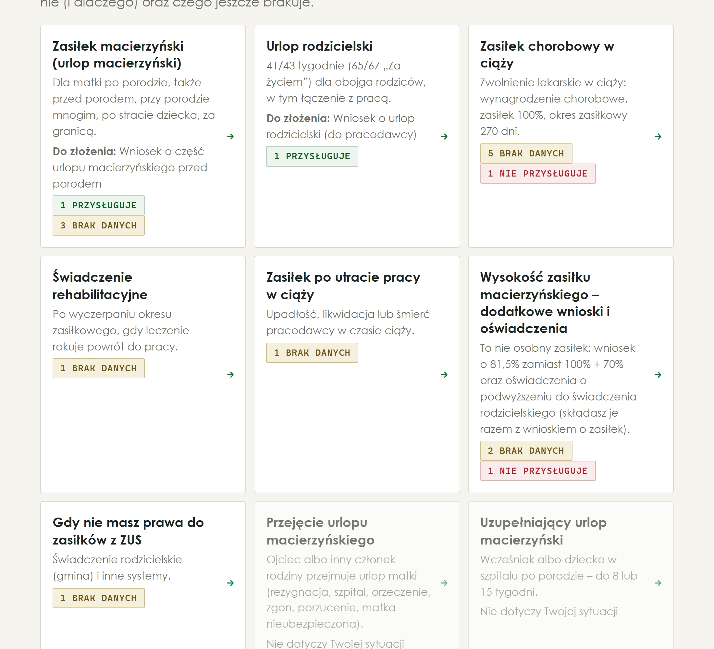 |
| **Wariant wniosku** – co, komu, do kiedy, ile i jakie dokumenty<br>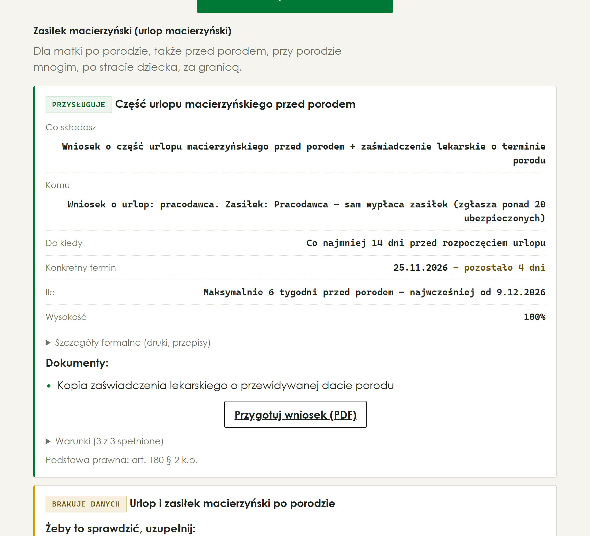 | **Generator wniosku** – pola z profilu, kontrola terminów, PDF<br>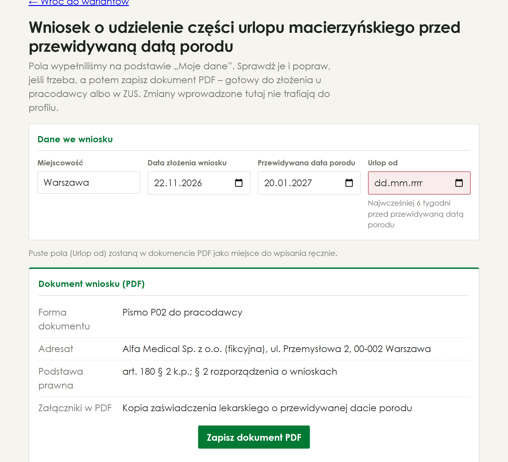 |
| **Kalendarz i powiadomienia** – przypomnienia 7 i 3 dni przed oraz w dniu terminu<br>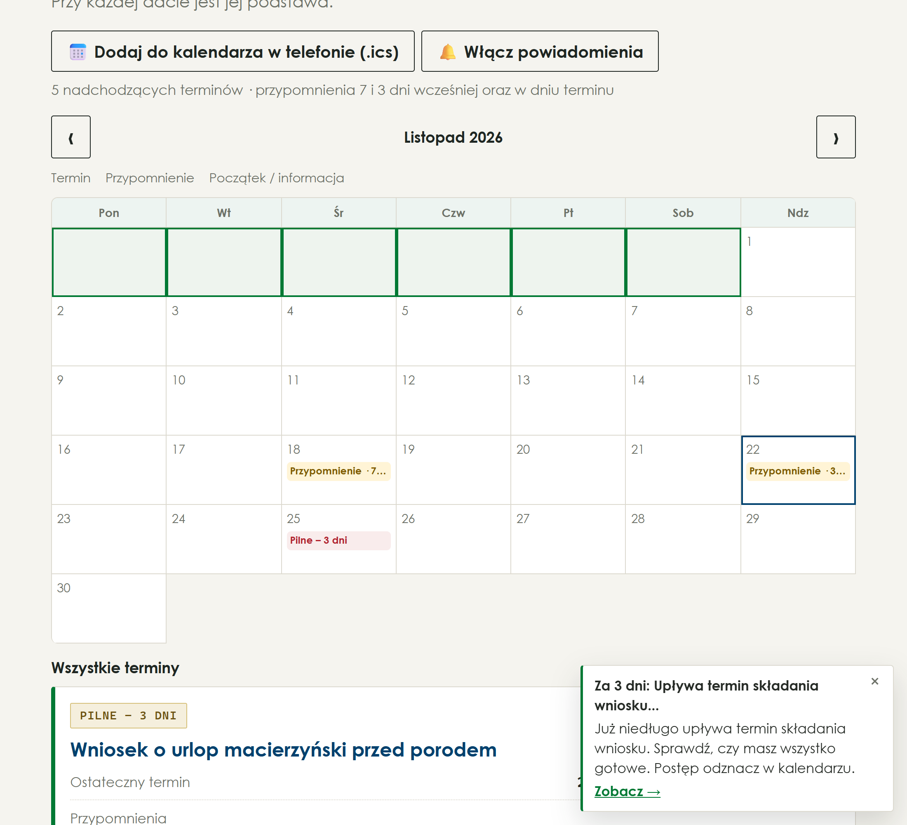 | **Wszystkie terminy** – z podstawą prawną przy każdej dacie<br>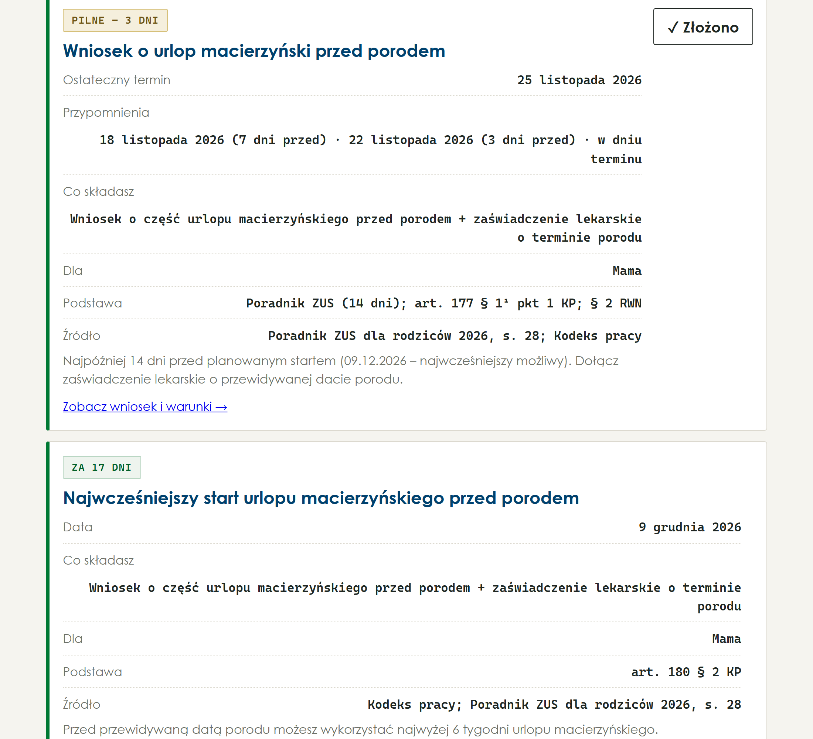 |
| **Kalkulator zintegrowany** – kalkulatory a–g na jednej stronie<br>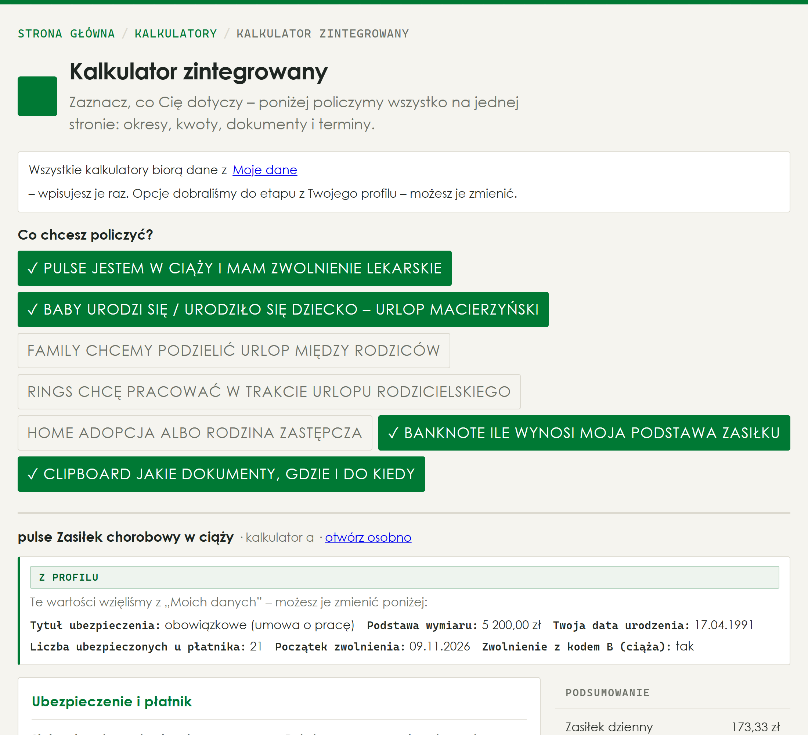 | **Dane z ZUS** (symulacja) – ubezpieczenie, podstawa, e-ZLA<br>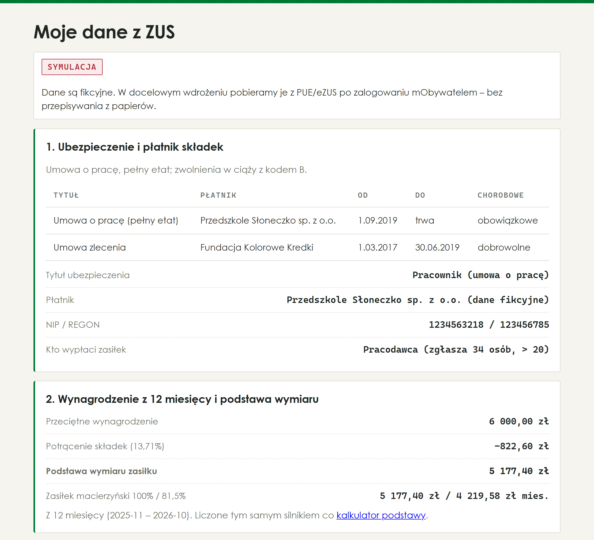 |
| **Logowanie** – symulacja mObywatela<br>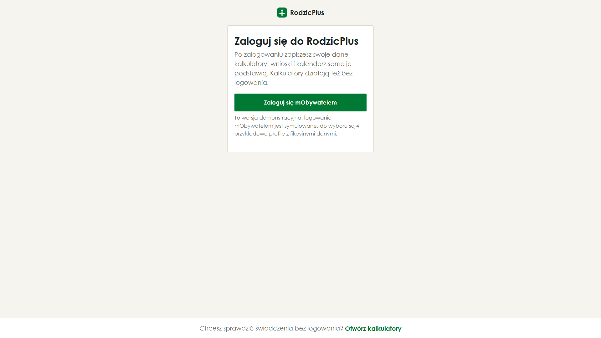 | **Wsparcie** – fundacje i hospicja perinatalne<br>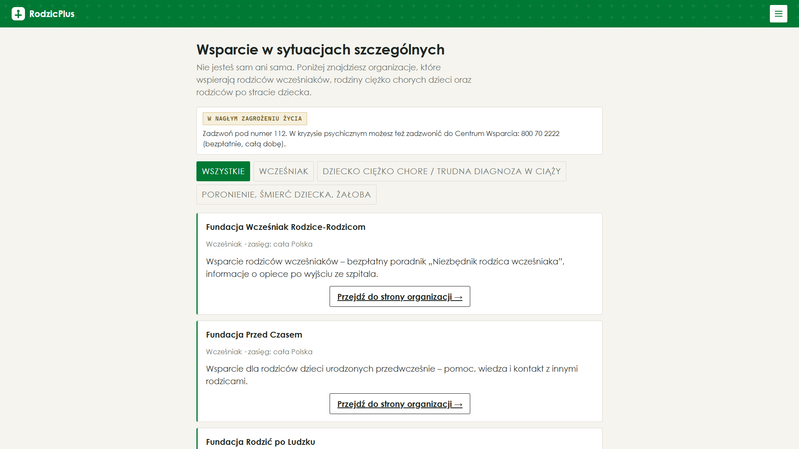 |
| **Telefon – panel**<br>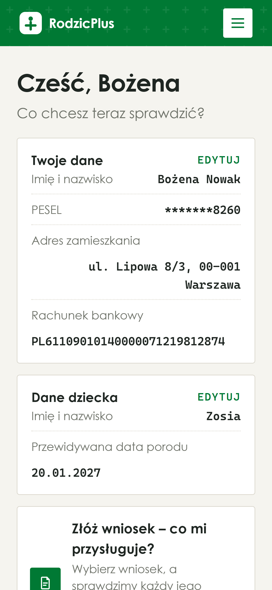 | **Telefon – kalendarz**<br>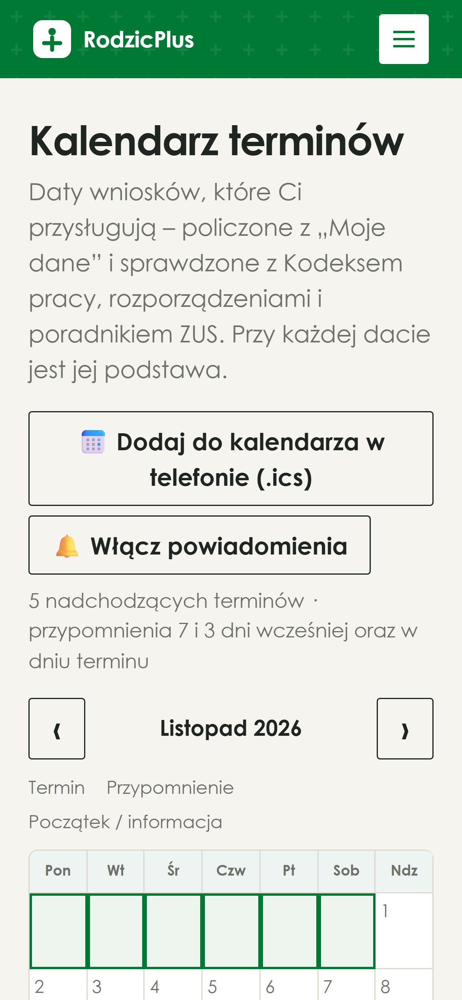 |

## Rozwiązania zewnętrzne

Zgodnie z § 4 ust. 1 regulaminu zadania: React, React Router, jsPDF (+ czcionka DejaVu Sans), Express, cors,
Vite, Vitest, yaml, Python + XeLaTeX/Tectonic, Docker, GitHub Actions, Google Cloud. Pełna lista z wersjami
i licencjami oraz tekst na slajd: [docs/rozwiazania-zewnetrzne.md](docs/rozwiazania-zewnetrzne.md).
Integracje ZUS / PUE / mObywatel / USC są wyłącznie symulowane (dane fikcyjne).

## Uruchamianie przez Docker Compose

Wymagany jest Docker z Compose. Z katalogu głównego projektu uruchom:

```sh
docker compose up --build
```

Frontend będzie dostępny pod adresem http://localhost:8080, a backend pod
http://localhost:3001. Dane backendu są przechowywane w wolumenie `backend-data`.
Zatrzymanie usług: `docker compose down`.

## Backend (port 3001)

```bash
cd backend && npm install && npm run dev
```

## Frontend (port 5173)

```bash
cd frontend && npm install && npm run dev
```

## Trasy (React Router)

Aplikacja korzysta z routingu po stronie klienta — każda podstrona ma własny adres,
który można odświeżyć lub wysłać komuś linkiem.

| Adres (np. na `http://localhost:5173`) | Opis |
| --- | --- |
| `/` | Przekierowanie: zalogowany → `/panel`, niezalogowany → `/logowanie` |
| `/logowanie` | Logowanie (symulacja mObywatela: Bożena, Marzena, Mariusz) |
| `/panel` | Panel użytkownika — **wymaga zalogowania** |
| `/profil` | „Moje dane” (dane do wniosków, podstawiane w kalkulatorach) — **wymaga zalogowania** |
| `/wnioski` | **Złóż wniosek**: 14 wniosków → każdy wariant oceniony na podstawie „Moje dane” (przysługuje / nie i dlaczego / brakuje danych) — **wymaga zalogowania**; `?w=<id>` otwiera konkretny wniosek |
| `/zus` | Symulacja „Moje dane z ZUS”: ubezpieczenie, podstawa, e-ZLA, zaświadczenie o niezaleganiu, wnioski PUE — **wymaga zalogowania** |
| `/odpis-aktu` | Symulacja wniosku o odpis aktu urodzenia (gov.pl) — **wymaga zalogowania** |
| `/kalkulatory` | Lista kalkulatorów |
| `/kalkulatory/zasilek-chorobowy-w-ciazy` | a) Zasiłek chorobowy w ciąży |
| `/kalkulatory/zasilek-macierzynski` | b) Zasiłek macierzyński |
| `/kalkulatory/laczenie-urlopu-z-praca` | c) Łączenie urlopu z pracą |
| `/kalkulatory/oboje-rodzice` | d) Symulacja obojga rodziców |
| `/kalkulatory/adopcja-rodzina-zastepcza` | e) Adopcja i rodzina zastępcza |
| `/kalkulatory/podstawa-wymiaru` | f) Podstawa wymiaru zasiłku |
| `/kalkulatory/dokumenty-i-terminy` | g) Dokumenty, terminy i zagrożenia |
| `/porownanie` | Porównanie 4 scenariuszy macierzyńskiego i rodzicielskiego — dostępne publicznie |
| `/admin` | Panel administratora: parametry kalkulatorów (brak linku w menu – wejście tylko przez adres) |
| dowolny inny | Strona 404 |

Nieznane adresy kalkulatorów (`/kalkulatory/cokolwiek`) pokazują stronę 404.
Trasa `/panel` przekierowuje na `/logowanie`, jeśli użytkownik nie jest zalogowany,
i po zalogowaniu wraca do miejsca, do którego zmierzał.

## Kalkulator zintegrowany

Kalkulator zintegrowany pod adresem `/kalkulatory/zintegrowany` pokazuje wszystkie
kalkulatory a–g na jednej stronie. Użytkownik zaznacza tylko sytuacje, które go dotyczą,
a aplikacja włącza odpowiednie formularze i wyniki. Wybór jest zapisany w adresie
`?opcje=a,b,f`, dzięki czemu można go odświeżyć lub skopiować.

Bez profilu domyślnie wybierane są podstawa wymiaru i dokumenty/terminy. Po zalogowaniu
i uzupełnieniu „Moich danych” domyślny zestaw dobiera się do etapu sprawy: ciąża, poród,
przyjęcie dziecka albo łączenie pracy z urlopem. Użytkownik może ręcznie zmienić wybór.

Ikony w zintegrowanym widoku i na liście kalkulatorów są spójnymi ikonami liniowymi SVG,
bez emoji i bez tekstowych skrótów nazw ikon.

## Porównanie W1–W4

Dodaliśmy publiczną stronę porównania czterech sposobów wykorzystania zasiłku macierzyńskiego
i rodzicielskiego pod adresem `/porownanie`. Strona porównuje warianty zmienne i uśredniony,
z udziałem taty oraz bez jego udziału. Pokazuje osobno stawki i kwoty miesięczne na każdym
etapie, sumę mamy, sumę taty, sumę rodziny, daty, przepadające tygodnie i termin złożenia
wniosku o wariant 81,5%.

Porównanie korzysta z tego samego silnika i parametrów co kalkulatory. Po zalogowaniu dane
mogą być podstawione z „Moich danych”. Strona działa również bez logowania i zawiera przełączalne
dane przykładowe:

- Bożena + Mariusz — etat i kompletne dane,
- Marzena — działalność gospodarcza z zaległością 312,40 zł,
- Marzena po spłacie zaległości — wariant dostępny wraz z ostrzeżeniem o ponownym zgłoszeniu
  dobrowolnego ubezpieczenia chorobowego.

W1 i W2 nie są porównywane jako „zysk” lub „strata”. Suma jest pokazana obok rozkładu
okresów, bo 20 tygodni po 100% + 32 tygodnie po 70% daje prawie taką samą pulę tygodni
równoważnych jak 52 tygodnie po 81,5%. Urlop ojcowski jest pokazany osobno i nie wchodzi
w sumę scenariuszy.

Symulacja ma charakter orientacyjny i nie wylicza ostatecznej decyzji ZUS. Liczby pochodzą
z parametrów w `frontend/src/engine/params.js` i mogą być zmienione w panelu `/admin`.

## Silnik obliczeń i testy

Wszystkie wyliczenia (podstawa wymiaru, zasiłek chorobowy, macierzyński, łączenie z pracą,
oboje rodzice, adopcja, kto wypłaca) są w `frontend/src/engine/` jako czyste funkcje bez
Reacta: `funkcja(dane, parametry) → wynik`. Komponenty w `frontend/src/calculators/` tylko
zbierają dane z formularza i wyświetlają wynik.

| Plik | Co liczy |
| --- | --- |
| `engine/params.js` | wszystkie stawki, limity i kwoty z przepisów (stan 2026) + opisy dla panelu admina |
| `engine/podstawa.js` | f) podstawa wymiaru: średnia z 12 mies., −13,71%, premie 1/12, minimum/maksimum |
| `engine/chorobowy.js` | a) zasiłek chorobowy w ciąży: okres oczekiwania, 33/14 dni, 182/270 dni, blokada za zaległość |
| `engine/macierzynski.js` | b) macierzyński, ojcowski, uzupełniający, martwe urodzenie, kwoty |
| `engine/laczenie.js` | c) rodzicielski łączony z pracą: wymiar ÷ (1 − etat) |
| `engine/oboje.js` | d) podział rodzicielskiego, walidacja planu, 9 tyg. ojca po 70% |
| `engine/adopcja.js` | e) adopcja / rodzina zastępcza: limity wieku, kwoty |
| `engine/platnik.js` | g) płatnik (> 20 ubezpieczonych) czy ZUS |
| `engine/porownanie.js` | Porównanie W1–W4, sumy mamy/taty/rodziny i daty porodu/PDP |
| `engine/engine.test.js` | testy z ręcznie policzonymi wartościami |
| `engine/wnioski/` | **wnioski i ich warianty**: co przysługuje przy danym profilu (niżej) |
| `calculators/useProfileDefaults.js` | **podstawianie danych z „Moich danych”** do kalkulatorów: komplet pól (podstawa, daty, staż ubezpieczenia, kod B, liczba ubezpieczonych, zaległość, wymiar etatu, tydzień ciąży, dni hospitalizacji) + pasek „Z PROFILU” pokazujący, co zostało wstawione |

Testy (361: kalkulatory, podstawianie profilu, porównanie W1–W4, logika formularza (płeć/rola), warianty wniosków, regresje do `RAPORT_BLEDOW.md`, spójność z bazą wiedzy oraz zgodność szablonów pism i LaTeX-a z YAML-em):

```bash
cd frontend && npm test
```

## Formularz „Moje dane” — logika zależna od płci i roli

Etykiety i widoczność pól zależą od tego, kim jesteś — żeby nie było pytań bez sensu:

| Sytuacja | Co widzisz |
| --- | --- |
| Kobieta, rola „matka” | etap **„Jestem w ciąży”** |
| Mężczyzna (każda rola) lub rola „ojciec” | etap **„Moja partnerka jest w ciąży”** + podpowiedź, że chodzi o ciążę drugiego rodzica |
| Kobieta | role: matka, inny członek rodziny (bez „ojciec”) |
| Mężczyzna | role: ojciec, inny członek rodziny (bez „matka”) |

**Dane z aktu urodzenia** (imię, nazwisko, PESEL, miejsce urodzenia dziecka) można uzupełnić
**także w ciąży** — wtedy jako opcjonalne, bo zwykle jeszcze ich nie znasz, ale możesz przygotować
je zawczasu. Data urodzenia pojawia się dopiero po porodzie. Pola opcjonalne nie blokują
ukończenia kroku (nie liczą się do paska postępu).

Logika jest w `src/profile-logic/etapy.js` (czysty JS, bez Reacta) i pokryta testami
`etapy.test.js` — m.in. sprawdzają, że żadna etykieta nie mówi mężczyźnie, że jest w ciąży,
a klucze etapów (`ciaza` / `po_porodzie` / `przyjecie`) pozostają zgodne z silnikiem wniosków.

## Kalkulatory a „Moje dane”

Kalkulatory nie każą niczego przepisywać. Po zalogowaniu dane lecą z profilu:

| Kalkulator | Co podstawia z profilu |
| --- | --- |
| a) chorobowy | tytuł ubezpieczenia (obowiązkowe/dobrowolne), podstawa, data urodzenia, **staż ubezpieczenia** (liczony z daty), **liczba ubezpieczonych u płatnika**, początek zwolnienia, **kod B** (ze `zdrowie.zwolnienie`), zaległość (kwota powyżej progu = blokada) |
| b) macierzyński | data porodu/PDP, podstawy obojga rodziców, „Za życiem”, martwe urodzenie/zgon, wniosek 81,5%, **dni hospitalizacji** (liczone z dat), tydzień ciąży, masa, plan ojcowski |
| c) łączenie z pracą | podstawa, liczba dzieci, **wymiar pracy**, stawka 81,5%/70% |
| d) oboje rodzice | podstawy obojga, wykorzystane tygodnie macierzyńskiego i rodzicielskiego, liczba części, wniosek 81,5% |
| e) adopcja | tryb (przysposobienie/rodzina zastępcza), data przyjęcia, data urodzenia, odroczenie szkolne, „Za życiem” |
| f) podstawa wymiaru | status, **wymiar etatu** (minimum liczone proporcjonalnie — art. 45 ust. 1 u.z.) |
| g) dokumenty | tytuł, liczba ubezpieczonych, zaległość, etap sprawy |

Płeć z PESEL-u decyduje, czy Twoje dane trafiają w pola „matka”, czy „ojciec”; dane drugiego rodzica
idą w pole przeciwne. Pasek **„Z PROFILU”** na górze kalkulatora pokazuje, co zostało podstawione —
nic nie jest nadpisywane ponownie, więc możesz dowolnie zmienić wartości. Niezalogowany widzi
zachętę do wypełnienia „Moich danych” i kalkulator na wartościach domyślnych.

## Wnioski i warianty („każdy wariant” – wymaganie mentorów ZUS)

Rodzic wypełnia „Moje dane”, wybiera wniosek, a silnik ocenia **każdy wariant** tego wniosku:

| Status | Znaczenie |
| --- | --- |
| `dostepny` | wszystkie warunki spełnione – są wymiar, wysokość, adresat, termin, dokumenty |
| `niedostepny` | warunek niespełniony – `powody` mówią który (np. „matka wykorzystała 10 z 14 tygodni”) |
| `brak_danych` | nic nie wyklucza, ale w profilu brakuje odpowiedzi – `brakujaceDane` z etykietami pól |
| `nie_dotyczy` | inna rola albo etap (np. urlop ojcowski dla matki) |
| `informacja` | zasada do pokazania bez oceny (np. ochrona przed zwolnieniem) |

| Plik | Zawartość |
| --- | --- |
| `engine/wnioski/rejestr.js` | **14 wniosków i 40 wariantów** opartych na `docs/01-katalog-swiadczen-2026.md`: warunki, wymiar, wysokość, adresat, formularz, termin, dokumenty, potrzebne pola, podstawa prawna; niepewne oznaczone `pewnosc: "do_potwierdzenia"`. Dokumentacja opisuje 50 pozycji — część jest **świadomie scalona** (np. W23/W24 → W6–W9b), a `spojnosc.test.js` pilnuje, by rejestr nie rozjechał się z bazą wiedzy |
| `engine/wnioski/kontekst.js` | profil z `GET /api/profile` → fakty dla reguł (tak / nie / brak danych) |
| `engine/wnioski/ocena.js` | `ocenWniosek(profil, wniosekId)`, `przegladWnioskow(profil)` i ostrzeżenia V1–V40 z `docs/02-dane-do-wnioskow-2026.md` |
| `engine/regresja.test.js` | testy regresyjne do każdego naprawionego błędu z `RAPORT_BLEDOW.md` (B-01…B-24) |
| `engine/wnioski/spojnosc.test.js` | spójność rejestru z `engine/dane/zus_dane_2026.json` (podstawy prawne, unikalność ID, pokrycie wniosków) |
| `engine/walidacja.js` | sanityzacja wejścia silnika (`NaN`/`Infinity`/wartości ujemne nie wchodzą do wyliczeń) |
| `engine/fuzz.test.js` | testy losowe (stałe ziarno, powtarzalne): 3000 losowych/„śmieciowych” profili przez wszystkie wnioski i 3000 wejść kalkulatorów – bez wyjątków, bez `NaN`/`undefined`/ujemnych kwot w tekstach, spójne statusy (np. `dostepny` ⇒ wszystkie warunki spełnione) i reguły biznesowe (limit łączenia, suma macierzyńskiego, 70% ojca ≤ 9 tyg.) |
| `engine/wnioski/wnioski.test.js` | testy na rodzinach: etat w ciąży, działalność z długiem, zlecenie (90 dni), studentka, utrata pracy w ciąży, ojciec przejmujący urlop (14 tyg., szpital, zgon, matka nieubezpieczona), wcześniak, martwe urodzenie, adopcja, 81,5%, rodzicielski, opiekuńczy |

Wniosek do druku: `frontend/src/pages/Druk.jsx` (`/wnioski/druk?v=W21`) + silnik `engine/wnioski/druki.js` – pismo do pracodawcy
(albo dane do ZAM dla osoby bez umowy o pracę) wypełnione z „Moje dane”, z oświadczeniami, załącznikami i kontrolą terminów;
przycisk „Zapisz PDF” pobiera **PDF z wypełnionego szablonu LaTeX-a** (`engine/wnioski/latexDokument.js`
przygotowuje treść, `engine/wnioski/pdfDokument.js` składa PDF przez jsPDF z polską czcionką),
zamiast otwierać okno drukowania (mockup). Testy: `engine/wnioski/druki.test.js`, `latexDokument.test.js`,
`pdfDokument.test.js` i fuzz.
Kompletny wniosek bez błędów można też „wysłać” (symulacja, `POST /api/wnioski/wyslij` w `backend/zus-mock.js`) –
dostaje numer (przy ZAM także UPO) i status, który zmienia się w czasie w „Dane z ZUS” → „Twoje wnioski”.

Ekran: `frontend/src/pages/Wnioski.jsx` (`/wnioski`) – kafelki wniosków z licznikami (najpierw to, co przysługuje),
ostrzeżenia dla całej sprawy, a po wyborze wniosku karta każdego wariantu: wymiar, wysokość, gdzie złożyć, termin,
dokumenty, rozwijane warunki ✓/✗/? i linki „uzupełnij w »Moje dane«” prowadzące do właściwego kroku profilu
(`/profil?krok=dziecko` itd.).

Przykład:

```js
import { ocenWniosek } from "./engine/index.js";
const { warianty } = ocenWniosek(profil, "przejecie");
// [{ id: "W22", status: "niedostepny", powody: ["Matka wykorzystała po porodzie co najmniej 14 tygodni…"], … }, …]
```

Źródła: `docs/01-katalog-swiadczen-2026.md` i `docs/02-dane-do-wnioskow-2026.md` – szkic przygotowany
z pomocą AI (Mistral) na podstawie materiałów ZUS; wymaga weryfikacji z przepisami.

## Szablony pism (gotowe do druku, LaTeX)

16 pism do ZUS/pracodawcy z `szablony_pism_2026.yaml` jest wygenerowanych do **LaTeX-a**:
`latex/szablony/P01.tex … P16.tex` (każdy kompiluje się osobno), `latex/szablony_pism.tex`
(wszystkie razem ze spisem treści) oraz `latex/decyzje_zus.tex` (struktura decyzji ZUS + wzór odwołania).
Pola do wypełnienia to kropkowana linia z podpisem. Ekran `/wnioski/druk` podstawia w te pola dane z formularza
(imiona, adresy, daty, dziecko, płatnika) i **zapisuje gotowy PDF** – nie otwiera już okna drukowania.
LaTeX jest źródłem układu i treści (bloki warunkowe są filtrowane według sprawy), a PDF składa jsPDF
z czcionką DejaVu (`frontend/public/fonts`). Dla wariantów bez własnego szablonu powstaje dokument ogólny
z tej samej preambuły.

```bash
python3 latex/gen_latex.py            # YAML → .tex (po każdej zmianie szablonów)
tectonic -X compile latex/szablony/P01.tex   # albo xelatex
```

Kompilacja wymaga **XeLaTeX/Tectonic** (polskie znaki przez `fontspec`/`polyglossia`, nie `inputenc`).
Szczegóły: `latex/README.md`. Test `latex.test.js` pilnuje, by pliki `.tex` nie rozjechały się z YAML-em.

## Symulacje usług ZUS i USC

Wszystkie integracje są zasymulowane (wymóg zadania). Dane są **fikcyjne** i zależą od osoby
wybranej przy logowaniu mObywatelem (`backend/zus-mock.js`):

| Osoba | Sytuacja w symulacji |
| --- | --- |
| Bożena | etat, pracodawca 34 osoby (wypłaca zasiłek sam), pensja 6 000 zł, e-ZLA z kodem B (ciąża) |
| Marzena | działalność gospodarcza, dobrowolne chorobowe, **zaległość 312,40 zł** → blokada zasiłku |
| Mariusz | etat, pracodawca 128 osób, pensja 7 500 zł, przyszły tata |

Strona `/zus` liczy podstawę wymiaru tym samym silnikiem co kalkulatory, a przycisk
„Przenieś do »Moje dane«” zapisuje tytuł ubezpieczenia, podstawę i płatnika w profilu,
więc kalkulatory od razu je podstawiają.

Endpointy (wymagają zalogowania): `GET /api/zus/dane`, `GET /api/zus/ezla`,
`GET /api/zus/zaswiadczenie?naDzien=RRRR-MM-DD`, `GET /api/zus/wnioski`,
`GET/POST /api/usc/odpisy` (wnioski o odpis trzymane w pamięci – po restarcie znikają).

